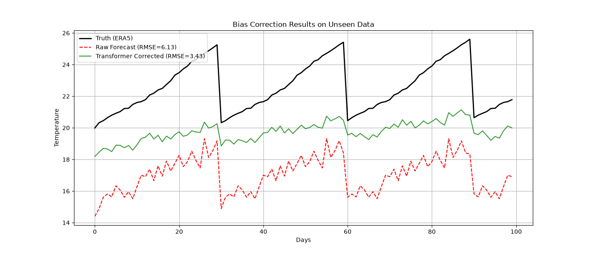
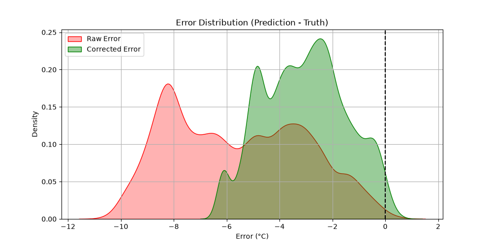
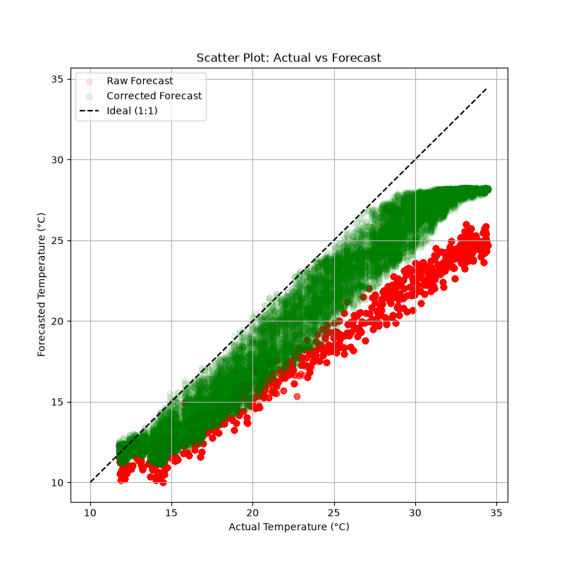

# AI in S2S: Transformer Bias Correction

  

## Overview
This repository contains a demonstration project designed to fulfill the core requirements of the **Planette AI: S2S Research Contractor** role. It showcases the ability to design, train, and evaluate a Transformer-based deep learning architecture for calibrating and bias-correcting deterministic and probabilistic climate forecasts on Subseasonal-to-Seasonal (S2S) time horizons.

Dynamical climate models (like NASA's or NCEP CFSv2) often exhibit persistent biases—such as amplitude underestimation or constant offsets—when predicting weeks to months in advance. This project implements a PyTorch Transformer that learns to map raw, biased forecasts into a "ground truth" target sequence (analogous to ERA5 reanalysis data).

## Key Features & Skills Demonstrated
* **Transformer Architectures**: Built a custom Sequence-to-Sequence PyTorch Transformer equipped with positional encoding, fully connected projections, and multiple multi-head attention layers.
* **Statistical Modeling & Bias Correction**: Handled systemic biases in raw forecast data to significantly reduce error distributions, demonstrating grounding in extreme event calibration.
* **Data Pipelines**: Processed simulated continuous time series into sliding context windows, framing the dataset for temporal self-attention.
* **Evaluation Metrics**: Used Root Mean Squared Error (RMSE) and visual correlations (scatter plots and density error estimations) to benchmark the corrected forecast against the raw output.

## Results
The trained Transformer successfully removed the systemic biases from the raw dynamical forecast. When applied to an unseen test set representing sequential "days", the architecture effectively learned to match the true amplitude and center of the synthetic ground truth data.

* **RMSE of Raw Forecast:** `6.13`
* **RMSE of Transformer Corrected Forecast:** `3.43`

  
  

*The Kernel Density Estimate (left) demonstrates how the Transformer re-centers the error around 0. The Scatter Plot (right) shows the Corrected Forecast closely adhering to the Ideal 1:1 prediction line compared to the Raw Forecast.*

## Repository Structure

- `src/transformer_bias_correction.py`: The complete PyTorch implementation. Contains the data generation, Transformer definition, training loop, and plotting scripts.
- `notebooks/transformer_bias_correction.ipynb`: The Jupyter Notebook environment mirroring the Python script.
- `index.html`: The static render of the Jupyter Notebook outputs (including all charts and training logs).
- `assets/*.png`: Evaluation graphs generated by the model.

## View the Interactive Notebook
The execution logs, code, and output charts are fully visible via GitHub Pages at:
[https://efkopru.github.io/transformer-bias-correction/](https://efkopru.github.io/transformer-bias-correction/)
